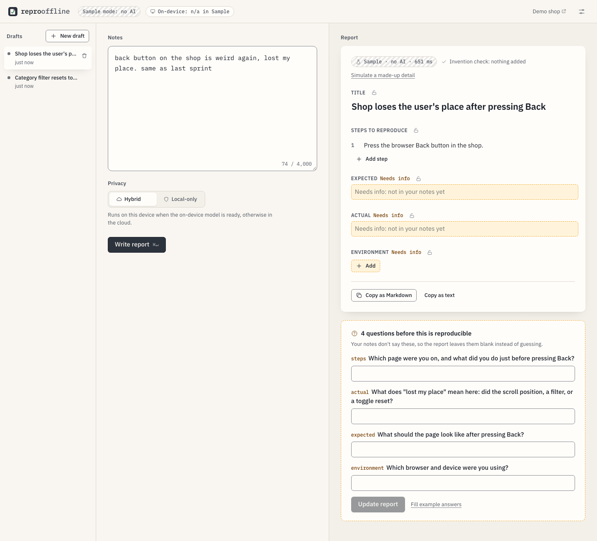
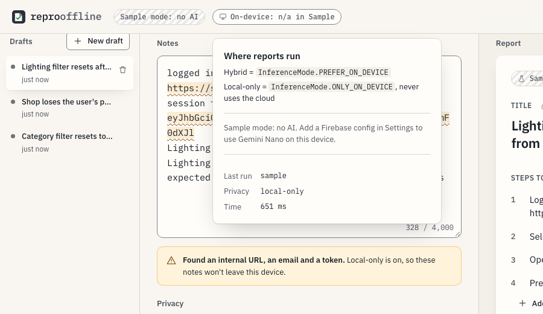
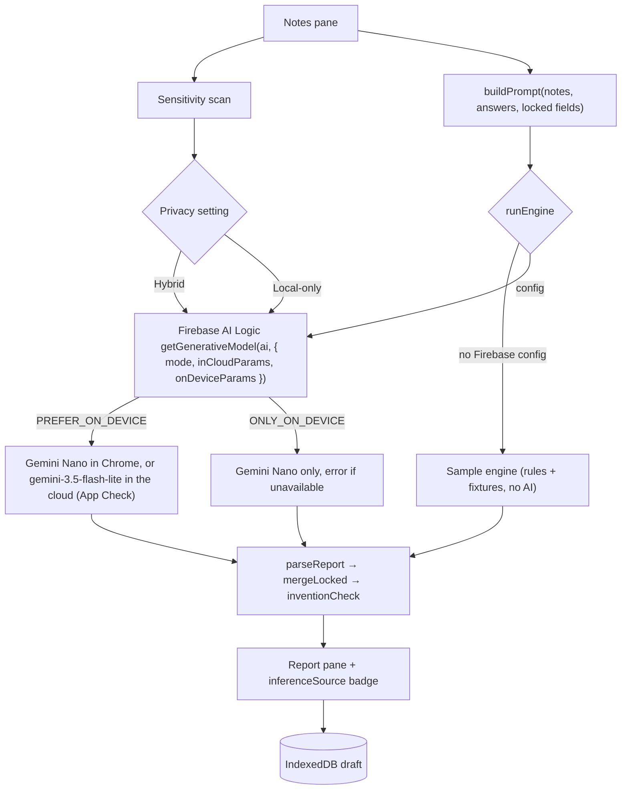

# Repro Offline

**Rough QA notes in, reproducible bug report out. It runs on your device, and it asks before it guesses.**

Built for the Firebase **#BuildHybridAI** hackathon (2026), targeting *Best Web/Chrome App*. It uses **Firebase AI Logic hybrid inference**: Gemini Nano in Chrome, with Gemini in the cloud as an optional fallback.


> The screenshots show **Sample mode** (no Firebase config, so no AI). Every report in them comes from the deterministic sample engine and is labelled `Sample · no AI`.

## The problem

A manual QA tester scribbles *"picked Tents, opened the Ridgeline tent, hit back, filter gone"* while testing. Later they have to turn that into a ticket another developer can reproduce. Two things go wrong:

1. **Missing details.** The ticket bounces back with "which browser?", "what did you expect?". General AI writers fill those gaps with confident guesses like "Chrome 120 on Windows 11", which is worse than leaving them blank.
2. **Internal details.** Rough notes contain staging URLs, test-account emails and session tokens, and testers are told not to paste those into cloud chatbots.

## What it does

- **Notes → structured report**: title, steps, expected, actual, environment. Every field is editable, and an edited field is **locked** so later runs keep it.
- **Asks instead of inventing.** Anything the notes don't say becomes a dashed **Needs info** gap plus a missing-info question. Answer the questions, press **Update report**, and it re-runs.
- **Invention check.** A deterministic check flags any version, browser, OS, device, URL, number or quote in the report that isn't in your notes or answers. You can **Remove** or **Keep** each flag.
- **Privacy routing.** A sensitivity scan finds emails, internal hosts, IPs and tokens in the notes and switches the draft to **Local-only** (`ONLY_ON_DEVICE`), which never falls back to the cloud.
- **Source badge.** Each report says where it actually ran (`On device`, `In cloud` or `Sample · no AI`), read from the SDK's `response.inferenceSource`. If a Hybrid run went to the cloud, it explains why.
- **Drafts** autosave to IndexedDB. **Copy as Markdown / text** asks for confirmation first if the report still contains internal details.
- **Trailhead Supply**: a small demo shop at `/demo-shop/index.html` with two planted bugs to write reports about.

| Vague notes become questions, not guesses | Sensitive notes switch to Local-only |
|---|---|
|  |  |

| Invention check flag | Engine panel (privacy setting → SDK mode) |
|---|---|
|  |  |

| Demo shop with planted bugs | Mobile (375 px) |
|---|---|
|  |  |

## The demo moment

Paste vague notes ("back button on the shop is weird again, lost my place") and you get a report that is **mostly gaps plus four specific questions**, not a confident fake. Answer them and the report fills in with only what you said. Then paste notes containing a staging URL, an email and a session token: the app underlines them, switches to **Local-only** on its own, and Firebase AI Logic runs in `ONLY_ON_DEVICE` mode. If Gemini Nano isn't available it stops with an error. It never uploads.

## How it works



## Firebase AI Logic hybrid, and why it is necessary

The product promise ("your notes don't leave this device") only works if the model can run locally, and the experience only works on more machines if there is a cloud fallback for the notes that *are* safe to send. That is exactly what hybrid inference provides.

| Privacy setting | SDK mode | Behaviour |
|---|---|---|
| Hybrid | `InferenceMode.PREFER_ON_DEVICE` | Gemini Nano when Chrome reports it `available`, otherwise `gemini-3.5-flash-lite` in the cloud. |
| Local-only | `InferenceMode.ONLY_ON_DEVICE` | Gemini Nano only. Unavailable → visible error, **no cloud call** ([ADR 0002](docs/adr/0002-local-only-never-falls-back.md)). |

What the code does (see [`src/engine/hybrid.ts`](src/engine/hybrid.ts), [`src/engine/firebase.ts`](src/engine/firebase.ts)):

- `import { getAI, getGenerativeModel, GoogleAIBackend, InferenceMode } from "firebase/ai"` and calls `generateContent` at runtime in Live mode (`firebase@^13.4.0`).
- **One JSON schema for both sources**: `inCloudParams.generationConfig.responseJsonSchema` for the cloud and `onDeviceParams.promptOptions.responseConstraint` for Chrome's Prompt API.
- **`response.inferenceSource`** drives the source badge. Before each run the app reads `LanguageModel.availability()` so it can explain a cloud run ("On-device model not downloaded yet. Press Prepare.").
- **Prepare on-device model** calls `model.initializeDeviceModel(onProgress)` from a click and shows a progress bar. `PREFER_ON_DEVICE` doesn't wait for a download, so without this step a fresh browser silently uses the cloud.
- **A finding we designed around:** the SDK's on-device path drops `systemInstruction` and `generationConfig`, so all instructions go into one self-contained prompt that both models receive ([ADR 0001](docs/adr/0001-instructions-inline-in-single-prompt.md), [RESEARCH](docs/RESEARCH.md)).
- **App Check** is initialised before any AI call: reCAPTCHA Enterprise if you give a site key, otherwise a debug token for localhost.
- A defensive invariant: if a Local-only run ever reports `in_cloud`, the result is discarded and an error is shown.

## Quickstart

Node 22.

```bash
npm install
npm run dev
# open http://localhost:5173
```

The app opens in **Sample mode**. Click one of the three example chips, then **Write report**. The demo shop is at http://localhost:5173/demo-shop/index.html.

Other commands: `npm test` (unit/component tests), `npm run e2e` (Playwright smoke test), `npm run build` (static build in `dist/`), `npm run preview` (serves the build on port 4173).

## Sample mode vs Live mode

| | Sample mode | Live mode |
|---|---|---|
| When | No Firebase config (default) | A Firebase web config pasted into **Settings** |
| Header | `Sample mode: no AI` (hatched chip) | `Live` |
| Reports | Fixed fixtures for the three examples, a deterministic rule engine for anything else. **No AI.** | Firebase AI Logic hybrid inference |
| Badge | `Sample · no AI` | `On device` or `In cloud` (from `inferenceSource`) |
| Extras | "Fill example answers" and "Simulate a made-up detail" for the demo | Prepare on-device model, why-cloud reasons |

Sample mode never loads the Firebase SDK (it is imported on demand only in the live path).

### Setting up Live mode

1. Create a Firebase project, then add a **Web app** and copy its `firebaseConfig`.
2. In the console, open **AI Logic**, get started, and choose the **Gemini Developer API**.
3. **App Check**: register the web app. For localhost, open *Manage debug tokens*, add a token, and paste the same token into Settings. For a hosted URL, use a reCAPTCHA Enterprise site key instead.
4. In the app, open **Settings** (top right), paste the config (JSON or the `const firebaseConfig = {…}` snippet) and the token or key, then **Save and reload**. Everything is stored only in this browser's localStorage.
5. For on-device runs use desktop **Chrome 139+**, enable `chrome://flags/#prompt-api-for-gemini-nano-multimodal-input`, restart Chrome, then open the **On-device** chip in the header and press **Prepare on-device model**. The download takes several minutes.

In debug mode the App Check SDK prints the debug token to the console, so keep DevTools closed when recording.

Deploy (owner): `npm run build && npx firebase-tools deploy --only hosting --project <your-project-id>` ([`firebase.json`](firebase.json) is included; no `.firebaserc` is committed).

## Judging criteria: where to find the proof

| Criterion | Proof | Where |
|---|---|---|
| Technological implementation | `getGenerativeModel` with `PREFER_ON_DEVICE` / `ONLY_ON_DEVICE`, one schema for `responseJsonSchema` + `responseConstraint`, `initializeDeviceModel` with progress, `inferenceSource` badge, why-cloud reason, App Check, mocked SDK tests | [`src/engine/hybrid.ts`](src/engine/hybrid.ts), [`src/engine/firebase.ts`](src/engine/firebase.ts), [`src/engine/availability.ts`](src/engine/availability.ts), [`tests/hybrid.test.ts`](tests/hybrid.test.ts) |
| Hybrid used meaningfully | Sensitivity scan forces `ONLY_ON_DEVICE`, which never falls back; Hybrid uses the cloud only when Nano isn't ready; the systemInstruction gap is designed around | [`src/domain/sensitivity.ts`](src/domain/sensitivity.ts), [docs/adr/](docs/adr/) |
| Design | Drafts, autosave, edit + lock, export, settings, empty/running/error states, ⌘/Ctrl+Enter, responsive layout, axe check | Screenshots above, [`e2e/smoke.spec.ts`](e2e/smoke.spec.ts) |
| Potential impact | A real hand-off (QA → developer) and a real constraint (internal data in notes) | [The problem](#the-problem) |
| Quality of idea | "Asks instead of invents", plus a deterministic invention check and a demo shop with planted bugs | [`src/domain/invention.ts`](src/domain/invention.ts), [`public/demo-shop/shop.js`](public/demo-shop/shop.js) |
| Requirements | `firebase` `^13.4.0`, runtime `firebase/ai` calls, App Check, MIT license | [`package.json`](package.json), [LICENSE](LICENSE) |

## Project structure

```
index.html                 app entry
public/demo-shop/          Trailhead Supply, the shop with planted bugs (plain HTML/CSS/JS)
src/domain/                report schema + parser, prompt, sensitivity scan, invention check, merge, markdown
src/engine/                firebase.ts (App + App Check + AI), hybrid.ts (Firebase AI Logic), availability.ts,
                           sample.ts (rule engine), run.ts (chooses Sample vs Live), errors.ts
src/store/                 settings (localStorage), drafts (IndexedDB via idb-keyval), useDrafts hook
src/fixtures/examples.ts   the three example notes and their fixtures
src/components/            React UI
tests/                     Vitest unit and component tests (firebase/ai mocked)
e2e/smoke.spec.ts          Playwright smoke test + axe accessibility check
docs/                      SPEC, PLAN, RESEARCH, GRILL (design interview), ADRs, screenshots
```

## Testing

Results from the last local run:

- `npm test`: **65 tests in 15 files passed** (Vitest, jsdom). Covers the parser, prompt, sensitivity scan, invention check (all fixtures give zero flags), sample engine, locked-field merge, settings parsing, App Check init order, the hybrid runner with `firebase/ai` mocked (mode mapping, shared schema, `inferenceSource` pass-through, Local-only never calling the SDK when Nano is unavailable, discarding an `in_cloud` Local-only result, error mapping), drafts storage and the main components.
- `npm run e2e`: **1 Playwright test passed** (Chromium). E1 report, E2 questions → example answers → updated report, E3 → Local-only + banner, and an axe scan with **zero serious or critical violations** on the E1 report screen.
- Manual check of the live path: with a deliberately fake config, the app called Firebase AI Logic and showed Firebase's "API key not valid" error in the error card, so the runtime call path is wired up. A successful live run was **not** verified (see below).

## Known limitations

- **Live hybrid inference was verified only with mocked SDK tests.** It needs the owner's Firebase project (AI Logic + App Check) and desktop Chrome with Gemini Nano. No real on-device or cloud report has been produced during development.
- On-device runs need desktop Chrome 139+ with the Prompt API flag. Other browsers can use Hybrid (cloud) or Sample mode only.
- Notes are capped at 4,000 characters to stay within the ~4096-token on-device limit.
- **No offline app shell yet.** The planned service worker (`vite-plugin-pwa`) and offline chip were cut for time, so the app needs a network connection to load the first time. Once loaded, Sample-mode runs and on-device runs need no network.
- The sample engine is a simple rule set. Outside the three examples its reports are rough, which is intended: it exists so judges can click through every screen without a config.
- In the dev server the demo shop lives at `/demo-shop/index.html` (`/demo-shop/` is caught by the app's SPA fallback).
- Changing Settings reloads the page, because App Check debug mode is read once per page load.

## Owner TODO

- [ ] Create the Firebase project, enable AI Logic (Gemini Developer API) and App Check, add a debug token.
- [ ] Run E1 in Hybrid and Local-only in Nano-capable Chrome and confirm the badge says **On device**.
- [ ] Deploy to Firebase Hosting and add the URL here.
- [ ] Record the ≤3 min video (script in [docs/SPEC.md §10](docs/SPEC.md)) and submit on Devpost before **Nov 30 2026, 5 pm ET**.

## How this was built

This project was planned and written with AI coding assistants (Claude Code): the product spec, design interview ([docs/GRILL.md](docs/GRILL.md)), ADRs and the code itself. The human owner set the direction and reviewed the result. API facts about Firebase AI Logic were checked against the installed SDK source and are recorded in [docs/RESEARCH.md](docs/RESEARCH.md).

## License

[MIT](LICENSE)
